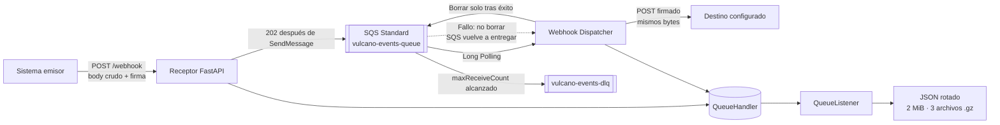

<div align="center">

# 🌋 Vulcano Pay

### TP-2 · Sistema de procesamiento de eventos

**Webhooks HMAC-SHA256 · AWS SQS · LocalStack · Observabilidad JSON**


</div>

Vulcano Pay recibe eventos de pago mediante webhooks, verifica su autenticidad y los encola para que un worker los entregue a un destino configurado. LocalStack emula SQS durante el desarrollo, mientras que los logs JSON se escriben de forma no bloqueante y se archivan comprimidos con Gzip.


## 🧭 Contenido

- [Arquitectura](#-arquitectura)
- [Contratos principales](#-contratos-principales)
- [Inicio rápido](#-inicio-rápido)
- [CLI](#-cli)
- [Configuración](#-configuración)
- [Pruebas](#-pruebas)
- [Estructura del proyecto](#-estructura-del-proyecto)
- [Alcance y mejora futura](#-alcance-y-mejora-futura)

## 🏗️ Arquitectura



La separación entre el receptor y el worker permite aceptar la notificación sin realizar la entrega externa dentro de la misma solicitud HTTP. Boto3 es síncrono: sus llamadas se ejecutan en hilos de trabajo; `asyncio.TaskGroup` supervisa los pollers del dispatcher.

## 🔐 Contratos principales

| Componente | Contrato |
|---|---|
| Receptor | `POST /webhook`; verifica la firma antes de parsear el JSON. Devuelve `202` solo si SQS aceptó el mensaje. |
| Firma | `X-Webhook-Signature: t=<timestamp>,v1=<hex>`; HMAC-SHA256 sobre `f"{timestamp}.".encode() + raw_body`. |
| Evento | JSON con `event_id`, `event_type`, `occurred_at`, `trace_id` y `payload`. |
| SQS | Cola principal `vulcano-events-queue`, DLQ `vulcano-events-dlq`; atributos `TraceId`, `EventTopic` y `Timestamp`. |
| Worker | Hace un intento HTTP por recepción y borra el mensaje solo tras una respuesta exitosa. Si falla, lo deja para redelivery de SQS. |
| Logs | JSON UTC mediante `QueueHandler`/`QueueListener`; archivos de 2 MiB y hasta 3 respaldos Gzip con renombrado atómico. |

### Respuestas HTTP

| Situación | Respuesta |
|---|---:|
| Firma ausente/inválida o timestamp fuera de tolerancia | `401 Unauthorized` |
| JSON inválido o evento incompleto | `400 Bad Request` |
| Publicación exitosa en SQS | `202 Accepted` |
| Error al publicar en SQS | `503 Service Unavailable` |

### Ejemplo de evento

```json
{
  "event_id": "evt-1",
  "event_type": "payment.settled",
  "occurred_at": "2026-11-02T12:00:00Z",
  "trace_id": "trace-1",
  "payload": {
    "transaction_id": "tx-123",
    "amount": 350.00,
    "currency": "ARS"
  }
}
```

## 🚀 Inicio rápido

### 1. Preparar Python y configuración

Se recomienda Python 3.14, que es la versión objetivo de la rúbrica:

```bash
python3.14 -m venv .venv
.venv/bin/pip install -r requirements.txt
cp .env.example .env
```

Editá `.env` y reemplazá `VULCANO_WEBHOOK_SECRET` por una clave local segura. El ejemplo incluye `test/test` únicamente para LocalStack; **no uses esos valores para AWS real**.

Exportá las variables en la terminal:

```bash
set -a
. ./.env
set +a
```

### 2. Iniciar LocalStack y crear las colas

Iniciá LocalStack en `http://localhost:4566`. El script requiere AWS CLI disponible en el `PATH` y configura la cola, la visibilidad y la política de redrive:

```bash
bash scripts/localstack_bootstrap.sh
```

Valores locales predeterminados: `VisibilityTimeout=30` segundos, `maxReceiveCount=5` y `WaitTimeSeconds=10`. La rúbrica no fija estos números; están documentados como valores del proyecto.

### 3. Iniciar los procesos

El receptor escucha por defecto en `0.0.0.0:8000`. El destino HTTP también debe estar activo en `VULCANO_DESTINATION_URL` (por defecto, `http://localhost:8080/webhook`). Ejecutá cada proceso en una terminal diferente:

```bash
PYTHONPATH=src .venv/bin/python -m app_operator start-dispatcher
```

```bash
PYTHONPATH=src .venv/bin/python -m app_operator start-receiver
```

Para comprobar la ayuda sin iniciar clientes ni servicios:

```bash
PYTHONPATH=src .venv/bin/python -m app_operator --help
```

## 🧰 CLI

| Subcomando | Uso |
|---|---|
| `produce-sqs` | Publica un evento validado directamente en SQS. No prueba la firma del receptor. |
| `start-receiver` | Inicia el servidor local `POST /webhook`. |
| `start-dispatcher` | Ejecuta los pollers SQS y envía los eventos al destino configurado. |

Ejemplo de publicación directa:

```bash
PYTHONPATH=src .venv/bin/python -m app_operator produce-sqs \
  --event-json '{"event_id":"evt-1","event_type":"payment.settled","occurred_at":"2026-11-02T12:00:00Z","trace_id":"trace-1","payload":{"transaction_id":"tx-123"}}'
```

Un emisor genera la firma así; `raw_body` debe contener exactamente los bytes que enviará:

```python
signature = generate_signature(secret, timestamp, raw_body)
header = f"t={timestamp},v1={signature}"
```

## ⚙️ Configuración

| Variable | Valor local | Propósito |
|---|---|---|
| `VULCANO_WEBHOOK_SECRET` | Requerida; reemplazar el placeholder | Clave HMAC. No se acepta como argumento CLI. |
| `VULCANO_SQS_ENDPOINT_URL` | `http://localhost:4566` | Endpoint de LocalStack. |
| `AWS_ACCESS_KEY_ID` / `AWS_SECRET_ACCESS_KEY` | `test` / `test` para LocalStack | Credenciales simuladas; remoto AWS usa el credential chain de Boto3. |
| `AWS_DEFAULT_REGION` | `us-east-1` | Región SQS. |
| `VULCANO_QUEUE_NAME` / `VULCANO_DLQ_NAME` | `vulcano-events-queue` / `vulcano-events-dlq` | Cola principal y DLQ. |
| `VULCANO_SQS_VISIBILITY_TIMEOUT_SECONDS` | `30` | Ventana antes de que un mensaje fallido vuelva a estar visible. |
| `VULCANO_SQS_MAX_RECEIVE_COUNT` | `5` | Umbral de redrive a la DLQ. |
| `VULCANO_RECEIVER_WAIT_TIME_SECONDS` | `10` | Long polling, válido entre 1 y 20 segundos. |
| `VULCANO_DESTINATION_URL` | `http://localhost:8080/webhook` | Destino fuera del mensaje SQS. |
| `VULCANO_TOLERANCE_SEC` | `300` | Tolerancia temporal de la firma. |
| `VULCANO_LOG_PATH` | `logs/vulcano_events.log` | Archivo activo de logs JSON. |

Las variables de cola y destino se validan antes de iniciar cada comando. Para destinos distintos por cliente, se debe resolver un identificador mediante configuración confiable; no se debe aceptar una URL arbitraria incluida en un evento.

## 📊 Observabilidad

Los logs se envían a disco exclusivamente a través de `QueueHandler` y `QueueListener`. Cada línea JSON incluye timestamp ISO 8601 UTC, nivel, evento, mensaje, proceso e hilo; agrega `TraceId`, `MessageId` y `WebhookId` cuando corresponda. Las excepciones se serializan recursivamente con sus grupos y notas.

El sistema **no registra** el body, secretos ni el valor utilizable de `X-Webhook-Signature`: solo registra si la firma estuvo presente y si pasó la validación. Los logs rotan a los 2 MiB, conservan tres respaldos y comprimen cada archivo `.gz` mediante un temporal y un renombrado atómico.

## 🧪 Pruebas

Pruebas unitarias y offline:

```bash
.venv/bin/ruff check src tests
.venv/bin/pytest -m "not localstack"
```

Pruebas de integración/caos con LocalStack (optativas):

```bash
VULCANO_RUN_LOCALSTACK_TESTS=1 .venv/bin/pytest -m localstack
```

Incluyen firma alterada, clave incorrecta, timestamp de una hora, mensajes venenosos y llegada a la DLQ, además de validación JSON UTC y descompresión Gzip. Si se opta por ejecutar las pruebas LocalStack y el servicio no está disponible, la prueba debe fallar visiblemente; no se silencian errores.

## 🗂️ Estructura del proyecto

```text
src/
├── app_operator.py              # Punto de entrada CLI
└── vulcano_telemetry/
    ├── __init__.py              # API pública del paquete
    ├── app_operator.py          # Coordinación y manejo de ExceptionGroup
    ├── config.py                # Configuración de entorno
    ├── core_sqs.py              # Productor, consumidor y DLQ Boto3
    ├── dispatcher.py            # Long polling y envío HTTP
    ├── event_schema.py          # Validación del evento sin reserializar el body
    ├── exceptions.py            # Excepciones semánticas
    ├── logging_engine.py        # Logging JSON asíncrono y Gzip
    ├── sanitizer.py             # Validadores CLI/configuración
    ├── webhook_crypto.py        # HMAC-SHA256 y timestamp
    └── webhook_receiver.py      # Receptor FastAPI
tests/
├── test_chaos.py
├── test_forensic_log.py
└── ...
```

## 💡 Alcance y mejora futura

Esta entrega sigue la consigna: los reintentos y la DLQ son responsabilidad de SQS; no se agrega un loop de reintentos en la aplicación ni un store SQLite de idempotencia. Como SQS Standard ofrece entrega *at-least-once*, un mismo `event_id` puede llegar más de una vez.

**Mejora posible, no implementada:** pedir al destino que deduplique usando `event_id` como clave de idempotencia. Sería valioso para notificaciones de pago porque reduce efectos duplicados; requiere soporte en cada destino y no convierte por sí solo una llamada HTTP externa en una operación *exactly-once*. Los detalles están en [la especificación](docs/requirements.md).
